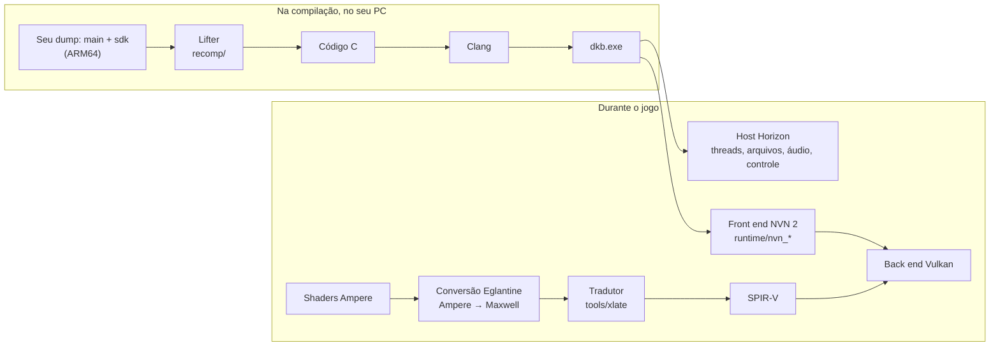

# DKB Recomp

[](LICENSE)
[](https://github.com/teasergames/dbk-recomp/releases)
[](https://github.com/Lucas-blip-png/dkb-pc-recomp)
[](https://ko-fi.com/lucasblippng)

> [!NOTE]
> **Esta é uma cópia não oficial** do [DKB Recomp](https://github.com/Lucas-blip-png/dkb-pc-recomp), de
> **Lucas-blip-png** e colaboradores, no commit
> [`db77cdf`](https://github.com/Lucas-blip-png/dkb-pc-recomp/commit/db77cdf). Todo o crédito pelo projeto é deles.
> Aqui você encontra o **instalador pronto (DKB-Setup)** na aba
> [Releases](https://github.com/teasergames/dbk-recomp/releases). Bugs do jogo, sugestões e contribuições vão para o
> [repositório original](https://github.com/Lucas-blip-png/dkb-pc-recomp/issues). Os documentos da pasta `docs/`
> continuam em inglês.

**DKB Recomp** é uma recompilação estática de *Donkey Kong Bananza* (Nintendo Switch 2, 2025) para um aplicativo nativo
de Windows x86-64 com renderizador Vulkan. Não há emulador rodando: o código ARM64 do jogo é traduzido para C
antecipadamente e compilado num único executável, e as chamadas gráficas são atendidas por uma implementação própria
da NVN 2. O projeto é baseado no [TotK Recomp](https://github.com/valentderah/totk-pc-recomp), que faz o mesmo com
*Tears of the Kingdom* no Switch original.

Até onde se sabe, não existe outra recompilação estática pública de um jogo de Switch 2.

> [!IMPORTANT]
> **Nenhum arquivo do jogo está incluído, nem nunca estará.** Você precisa da sua própria cópia de *Donkey Kong
> Bananza*, extraída (dump) do seu próprio console. Não serão dadas instruções de como obter esses arquivos. Não existe
> executável do jogo para download: cada pessoa gera o seu a partir do próprio dump.

## Instalação rápida (DKB-Setup)

1. Baixe o `DKB-Setup-<versão>-windows.zip` em [Releases](https://github.com/teasergames/dbk-recomp/releases) e
   extraia em qualquer pasta. O zip tem **só ferramentas e código-fonte**, nada do jogo.
2. Abra o **`DKB-Setup.exe`**.
3. Escolha as pastas `exefs` e `romfs` do **seu** dump (versão **base 1.0.0**), o idioma e uma pasta de destino vazia.
4. Aguarde de 20 a 30 minutos (verificação do dump, compilação e tradução dos shaders).
5. Jogue pelo `dkb.exe` na pasta de destino.

**Requisitos:** Windows 10 ou 11, CPU com AVX2, GPU com Vulkan 1.3, 16 GB de RAM (32 GB recomendado) e cerca de 45 GB
livres durante a instalação.

## Estado

**Ainda não é jogável do começo ao fim.** O jogo inicia, passa pela tela de título até a caverna do tutorial,
renderiza a cena 3D e responde ao controle: dá para andar e socar pelo túnel de mineração, com os vídeos de guia
tocando, e uma partida jogada à mão chegou à seção Ingot Isle Cave-In. Ainda pode travar (na NVIDIA, dois quads de luz
são pulados para evitar uma falha da GPU,
[#9](https://github.com/Lucas-blip-png/dkb-pc-recomp/issues/9)), e muitos efeitos estão faltando.
O instalador gera o jogo a partir do seu dump: [docs/installer.md](docs/installer.md).
Progresso dia a dia: [docs/devlog.md](docs/devlog.md).

| Fase | | Estado |
| --- | --- | --- |
| F0 CPU | ✅ | `main` e `sdk` (180.061 funções) são traduzidos sem nenhuma instrução sem suporte (foram adicionados autenticação de ponteiros do ARMv8.3 e `LDAPR`). Os testes diferenciais contra o Unicorn passam. |
| F1 SO | ✅ | Inicia no host Horizon do TotK Recomp com as diferenças do Switch 2: RomFS, saves, áudio e controle. |
| F2 NVN 2 | ✅ | 700 pontos de entrada da NVN 2 atendidos; o loop do jogo roda. 51 novas chamadas de command buffer (mesh shaders, VRS, DLSS, push constants…) são aceitas, mas ainda não gravadas. |
| F3 Shaders | ✅ | Todos os 4.820 estágios de shader Ampere da primeira cena 3D passam pela conversão Ampere→Maxwell do Eglantine e pelo tradutor do TotK Recomp para SPIR-V. |
| F4 Vulkan | ✅ | A tela de título e a cena 3D do tutorial são renderizadas. |
| F5 Jogável | 🚧 | Controle, vídeos de guia (VP9) e push constants funcionam. Em aberto: falha da GPU depois de alguns minutos na NVIDIA, o terreno destrutível preto (seu estágio de geometria, [#45](https://github.com/Lucas-blip-png/dkb-pc-recomp/issues/45)), algumas texturas e o desempenho fora do tutorial. |

O plano, fase por fase: [docs/bananza-plan.md](docs/bananza-plan.md). O que está em aberto agora:
[Roadmap até ficar jogável](https://github.com/Lucas-blip-png/dkb-pc-recomp/issues/10).

## Como funciona



A versão longa está em [docs/architecture.md](docs/architecture.md) (compartilhado com o TotK Recomp) e
[docs/bananza-shaders.md](docs/bananza-shaders.md) (o trabalho com shaders da NVN 2), ambos em inglês.

## Como ajudar

Contribuições vão para o [projeto original](https://github.com/Lucas-blip-png/dkb-pc-recomp). Cada problema em
aberto é um trabalho separado, com sua própria issue. Escolha um, avise na issue que você está nele e mantenha cada
pull request em um só assunto. Issues marcadas como
[`in progress`](https://github.com/Lucas-blip-png/dkb-pc-recomp/issues?q=is%3Aopen+label%3A%22in+progress%22) já
estão com alguém, e o topo do [roadmap](https://github.com/Lucas-blip-png/dkb-pc-recomp/issues/10) diz o que está
sendo feito agora.

**Sem programar**, só com seu PC e sua cópia do jogo:

- [#3](https://github.com/Lucas-blip-png/dkb-pc-recomp/issues/3) **Teste na sua GPU.** Até agora tudo foi verificado
  numa única placa NVIDIA. Testes em AMD, Intel e outras NVIDIA, com logs, mostram o que quebra nelas.
- [#7](https://github.com/Lucas-blip-png/dkb-pc-recomp/issues/7) **Jogue além do tutorial** e conte onde parou.
- [#9](https://github.com/Lucas-blip-png/dkb-pc-recomp/issues/9) **A falha da GPU depois do primeiro vídeo de guia**:
  vista em três drivers NVIDIA (617.14, 617.42, 621.01); testes em AMD e Intel mostrariam se é coisa da NVIDIA.

**Com código** ([help wanted](https://github.com/Lucas-blip-png/dkb-pc-recomp/issues?q=is%3Aopen+label%3A%22help+wanted%22)):

- [#5](https://github.com/Lucas-blip-png/dkb-pc-recomp/issues/5) **Texturas quadriculadas** em algumas superfícies de
  pedra. O layout GOB do Switch 2 (f4f7b17) corrige a pedra dourada da caverna do tutorial; as outras superfícies
  ainda precisam ser verificadas.
- [#6](https://github.com/Lucas-blip-png/dkb-pc-recomp/issues/6) **Chamadas da NVN 2 ainda não gravadas**: mesh
  shaders, VRS, DLSS e outras.
- **Símbolos.** Nomes de funções ajudam na depuração. Eles vêm do
  [GRAnimated/DKBananza](https://github.com/GRAnimated/DKBananza), que também aceita contribuições.

Antes de abrir um pull request, leia o [CONTRIBUTING.md](CONTRIBUTING.md). A regra principal: nada que saiu do jogo
entra no repositório, nem em commits, issues ou pull requests. Rode `python tools/check_content.py --staged` antes de
fazer commit; o CI roda a mesma verificação. Dúvidas vão para as
[Discussions](https://github.com/Lucas-blip-png/dkb-pc-recomp/discussions) do projeto original. Todos que participam
seguem o [código de conduta](CODE_OF_CONDUCT.md).

## Apoie o projeto

Se quiser apoiar o autor sem programar, as gorjetas vão para
[ko-fi.com/lucasblippng](https://ko-fi.com/lucasblippng). A gorjeta paga tempo de trabalho no projeto; ela não compra
arquivos do jogo, builds nem acesso antecipado, e tudo continua open source. Dar estrela no
[repositório original](https://github.com/Lucas-blip-png/dkb-pc-recomp) e divulgá-lo para quem entende de GPUs, ARM64
ou do Switch também ajuda.

## Compilando a partir do código-fonte

Quem prefere não usar o DKB-Setup pode compilar manualmente. O toolchain é o do TotK Recomp
([docs/building.md](docs/building.md)): Clang do MSYS2 UCRT64, Ninja, Python 3.12 e o .NET SDK para o tradutor de
shaders. Com o ExeFS e o RomFS do Bananza do seu dump:

```
.venv\Scripts\python tools\build_xlate.py
.venv\Scripts\python recomp\gen.py --exefs <exefs> --out generated\dkb100 --modules main,sdk --patches recomp\patches-dkb100.txt
.venv\Scripts\python tools\dkb_expected.py --exefs <exefs> --name dkb100 --display 1.0.0
.venv\Scripts\python tools\dkb_pack_romfs.py --dir <pasta romfs> --out build\extracted\dkb100\romfs
.venv\Scripts\python tools\build_game.py --version dkb100 --expected tools\data\expected-dkb100.json --exefs <exefs> --romfs build\extracted\dkb100\romfs
```

Tudo o que a compilação gera fica em `build\` e `generated\`, que o git ignora. O jogo usa cerca de 14 GB de memória
(13,5 GiB no início e 13,75 GiB depois de 40 minutos, subindo uns 6 MB por minuto; sessões mais longas não foram
testadas). Por isso 16 GB de RAM com um arquivo de paginação grande é o mínimo por enquanto, e 32 GB é o confortável.
Como rodar e testar: [docs/dkb-testing.md](docs/dkb-testing.md).

> [!TIP]
> Se for usar o instalador direto do código-fonte (`python -m installer`) com o MSYS2, instale também o pacote
> `mingw-w64-ucrt-x86_64-llvm-tools`. O instalador espera o toolchain **llvm-mingw** (com libc++) em
> `toolchain\llvm-mingw-*\` e as bibliotecas em `toolchain\deps-mingw\`. O DKB-Setup já traz tudo isso pronto.

## Perguntas frequentes

**Dá para jogar?** Ainda não do começo ao fim. Chega ao tutorial e trava com frequência. Acompanhe o
[roadmap](https://github.com/Lucas-blip-png/dkb-pc-recomp/issues/10) ou o [devlog](docs/devlog.md).

**Vai ter download do jogo pronto?** Não. O executável é feito a partir do próprio código do jogo, então não pode ser
compartilhado. Cada um gera o seu a partir do próprio dump; o DKB-Setup faz isso por você.

**Qual versão do jogo?** Base 1.0.0. A atualização 458752 tem outro layout e ainda não é suportada.

**Linux?** O toolchain do TotK Recomp suporta Linux, então é possível; ninguém testou com o Bananza ainda.

**Por que GPL?** A conversão de shaders vem do Eglantine (Eden Emulator Project), que é GPL. Os arquivos que vieram do
TotK Recomp mantêm a licença MIT.

**Como a IA é usada?** A maior parte do código e da documentação é escrita por agentes de programação com IA (Claude
Code), como no TotK Recomp, e verificada rodando o jogo e os testes diferenciais. Pull requests feitos com ajuda de IA
são bem-vindos; você é responsável por ter lido e rodado o que enviar.

## Créditos e origem

O DKB Recomp é baseado no [TotK Recomp](https://github.com/valentderah/totk-pc-recomp) (*Tears of the Kingdom*,
Switch 1), de valentderah e colaboradores (MIT, mantida em [LICENSE-MIT](LICENSE-MIT)). Usa a conversão de shaders
Ampere do Eglantine (GPL-3.0-or-later, `runtime/third_party/eglantine/`) e o tradutor de shaders do Ryujinx (MIT,
incluído com os patches do MacNativeGames), além dos outros projetos listados em
[THIRD_PARTY_NOTICES.md](THIRD_PARTY_NOTICES.md). O conjunto está sob a [LICENSE](LICENSE).

- [DKB Recomp](https://github.com/Lucas-blip-png/dkb-pc-recomp), de Lucas-blip-png e colaboradores, o projeto original.
- [TotK Recomp](https://github.com/valentderah/totk-pc-recomp), de valentderah, a base de tudo aqui, e os projetos em
  que ele se apoia: [LAS Recomp](https://github.com/peiikai/LASRecomp),
  [MacNativeGames](https://github.com/ly05010419/MacNativeGames), [nxnative](https://github.com/seedds/nxnative),
  [SavageWindRecomp](https://github.com/Revivedx/SavageWindRecomp), [Ryujinx](https://github.com/Ryujinx/Ryujinx),
  [deko3d](https://github.com/devkitPro/deko3d), [hactool](https://github.com/SciresM/hactool) e os demais listados em
  [THIRD_PARTY_NOTICES.md](THIRD_PARTY_NOTICES.md).
- [GRAnimated/DKBananza](https://github.com/GRAnimated/DKBananza), pelos símbolos e pela pesquisa sobre o jogo.
- [Eglantine](https://git.eden-emu.dev/Franseven/PokeDinner-a-Eglantine-Fork) (Eden Emulator Project), pela conversão
  de shaders Ampere→Maxwell e pelas notas sobre o Switch 2, e o [Mesa NAK](https://gitlab.freedesktop.org/mesa/mesa),
  pelas codificações SM70+ em que ambos se baseiam.
- [libvpx](https://chromium.googlesource.com/webm/libvpx), pelos vídeos.
- [Switchbrew](https://switchbrew.org), pelos ids de `GetInfo` do Switch 2, e a comunidade de homebrew do Switch.

## Licença

O DKB Recomp como um todo está sob a [GNU GPL v3 ou posterior](LICENSE), porque inclui a conversão de shaders Ampere do
Eglantine, que é GPL (`runtime/third_party/eglantine/`). Os arquivos que vieram do TotK Recomp mantêm a
[licença MIT](LICENSE-MIT); código de terceiros mantém sua própria licença
([THIRD_PARTY_NOTICES.md](THIRD_PARTY_NOTICES.md)). A licença não concede nenhum direito sobre o jogo da Nintendo.

O DKB Recomp é um projeto de fã independente e sem fins comerciais, sem afiliação com a Nintendo nem endosso dela.
*Donkey Kong Bananza* e *Nintendo Switch 2* são marcas registradas da Nintendo.
